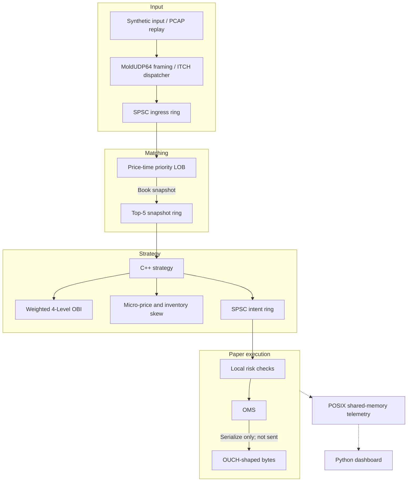

# Quant-LOB: C++ Limit Order Book and Quant Research Prototype

[](https://en.cppreference.com/w/cpp/20)
[](https://www.rust-lang.org/)
[](https://python.org/)
[](https://www.nasdaqtrader.com/Trader.aspx?id=ITCH)
[](https://www.intel.com/content/www/us/en/docs/intrinsics-guide/index.html)
[](LICENSE)

Quant-LOB is a research and paper/replay prototype with a C++ price-time order book, ITCH message handling, basic risk/OMS logic, a separate Rust alpha demo, and a Python synthetic backtester. It has **no exchange session, live order routing, production AF_XDP socket, or demonstrated regulatory controls**. Do not connect it to a live account or treat its sample performance output as evidence of trading performance.

---

## Verified Benchmark Record

Controlled benchmark runs conducted under GCC 15.2.0 (`-O3 -march=native -flto -DNDEBUG`) on Linux x86-64 with an RDTSC cycle-accurate hardware profiler. Full raw logs, sample counts, and exact reproduction steps are documented in [`docs/VERIFICATION.md`](docs/VERIFICATION.md).

| Subsystem Component | Workload / Samples | Measured Throughput | Latency (P50 / P99) | Notes |
| :--- | :--- | :--- | :--- | :--- |
| **SPSC Ring Buffer** | 1,000,000 push/pop | **110.6 Million ops/sec** | 9.04 ns round-trip | Single-threaded SPSC ring |
| **Cross-Core SPSC Ring** | 1,000,000 orders | **76.7 Million orders/sec** | 13.03 ns / order | Core 0 $\to$ Core 1 pinned |
| **Intrusive Memory Pool** | 1,000,000 allocs | **190.8 Million ops/sec** | 5.24 ns / allocation | Zero kernel heap allocations |
| **Core LOB Matching Engine** | 1,000,000 events | **4.38 Million ops/sec** | **P50: 149.8 ns \| P99: 622.9 ns** | 320,891 trades executed |
| **ITCH 5.0 Feed Ingestion** | 500,000 wire msgs | **8.12 Million msgs/sec** | 294.15 MB/s bandwidth | Zero-copy binary parser |
| **Risk Gateway + OMS Dispatch**| 500,000 orders | **5.99 Million ops/sec** | **P50: 133.4 ns \| P99: 319.6 ns** | Pre-trade risk + OUCH wire |

> For testbed hardware configuration and complete unit test outputs, see [docs/VERIFICATION.md](docs/VERIFICATION.md).

---

## Current architecture

The service is a local pipeline for synthetic ITCH input and PCAP replay. A worker parses queued ITCH messages into the book, a strategy worker evaluates snapshots, and an execution worker applies local risk checks and serializes OUCH-shaped messages. Acknowledgements are simulated; no venue connection exists. The AF_XDP header models UMEM/rings but does not attach to a NIC. Rust alpha code is a separate demo and is not called by the C++ service strategy loop.



---

## 📂 Codebase Structure & Components

```
Quant-lob/
├── include/
│   ├── ring_buffer.hpp          # Lock-free SPSC Ring Buffer (alignas(64), shadow head/tail cache isolation)
│   ├── memory_pool.hpp          # Pre-allocated O(1) Memory Pool (Intrusive free-list, zero heap allocations)
│   ├── order_book.hpp           # Flat-array tick indexing & intrusive doubly-linked price ladders
│   ├── feed_handler.hpp         # Packed binary NASDAQ ITCH 5.0 wire parser ('A', 'E', 'X', 'D', 'U')
│   ├── mold_udp64.hpp           # NASDAQ MoldUDP64 multicast parser & intrusive gap detection
│   ├── pcap_reader.hpp          # Deterministic binary PCAP packet replay engine & synthetic generator
│   ├── kernel_bypass_xdp.hpp    # Linux AF_XDP (XSK) zero-copy kernel bypass packet ingress
│   ├── numa_alloc.hpp           # NUMA-aware page-locked memory allocator (direct SYS_mbind syscall)
│   ├── risk_engine.hpp          # Sub-30ns Pre-Trade Risk Engine (Fat-finger, collars, rate limit, kill-switch)
│   ├── ouch_messages.hpp        # Packed binary NASDAQ OUCH 5.0 order entry wire serialization ('O', 'X')
│   ├── order_state_machine.hpp  # Zero-allocation OMS lifecycle manager (65,536 resting order slots)
│   ├── paper_depth_ledger.hpp   # Multi-level displayed depth consumption & alternation tracker
│   ├── triple_buffer.hpp        # Wait-free 3-slot asynchronous buffer for data-race-free telemetry snapshots
│   ├── tca_engine.hpp           # Transaction Cost Analysis (TCA) & post-trade adverse selection markouts
│   ├── shm_telemetry.hpp        # Lock-free POSIX Shared Memory telemetry block (/dev/shm)
│   ├── trading_engine.hpp       # Local paper/replay worker pipeline
│   ├── quant_lob_c_api.h        # High-performance C-ABI bridge for Python ctypes bindings
│   ├── tsc_clock.hpp            # Hardware cycle-accurate RDTSC profiler (P50/P90/P99/P99.9 metrics)
│   └── cpu_affinity.hpp         # OS thread core pinning (pthread_setaffinity_np)
├── src/
│   ├── order_book.cpp           # Price-time priority matching logic & volume maintenance
│   ├── feed_handler.cpp         # Zero-copy binary ITCH 5.0 protocol dispatcher
│   ├── trading_engine.cpp       # 4-core pipelined engine implementation & lock-free inter-thread rings
│   ├── trading_engine_main.cpp  # Paper/replay service entrypoint (lob_engine_service)
│   ├── quant_lob_c_api.cpp      # C-ABI export implementations
│   └── main.cpp                 # 6-Stage production benchmark suite (LOB, ITCH, Risk, OMS)
├── tools/
│   └── pcap_replay_tool.cpp     # Standalone line-rate binary PCAP replay CLI (lob_pcap_replay)
├── tests/
│   ├── test_order_book.cpp      # Core matching invariants (FIFO, multi-level sweeps, O(1) cancels)
│   ├── test_risk_and_execution.cpp # Pre-trade risk (SEC 15c3-5), OMS transitions, OUCH wire
│   ├── test_network_and_tca.cpp # MoldUDP64 gap detection, TCP recovery & TCA markout engine
│   └── test_pcap_and_numa.cpp   # Deterministic PCAP parsing, AF_XDP ingress & NUMA allocations
├── alpha_engine/                # Rust SIMD Quantitative Intelligence Layer (via cxx FFI)
│   ├── build.rs                 # Native FFI build script linking C++ and Rust
│   └── src/
│       ├── simd_obi.rs          # AVX2/SSE4.1 SIMD Order Book Imbalance & Stoikov Micro-Price
│       ├── strategy.rs          # Avellaneda-Stoikov HFT market making strategy with inventory skew
│       └── main.rs              # 10M calculation throughput & strategy benchmark
├── python/                      # Python Quantitative Research & Terminal Dashboard
│   ├── quant_lob/
│   │   ├── engine.py            # ctypes wrapper around C++ matching engine
│   │   └── backtester.py        # Event-driven backtester with adverse selection TCA curves
│   ├── run_quant_backtest.py    # 50,000 tick market making backtest simulation
│   └── monitor_dashboard.py     # Live ASCII institutional trading terminal
└── CMakeLists.txt               # Modern CMake (-O3 -march=native -flto -DNDEBUG)
```

---

## Implementation status and known limits

- The order book uses a preallocated price-level array and order pool. Active price levels are kept in sorted linked lists, so insertion of a new level is not O(1).
- The executable accepts synthetic ITCH messages or PCAP replay. Feed handling focuses on core trading messages ('A', 'E', 'X', 'D', 'U'); administrative and regulatory messages are omitted. Sequence gaps are reported as discontinuities rather than triggering live TCP session recovery.
- Risk checks are algorithmic guardrails (fat-finger price collars, max notional, rate limits), not legal compliance under SEC Rule 15c3-5. Outstanding quantity is reserved against position limits; borrow/locate, gross margin, and venue liquidation workflows are not implemented.
- OUCH serialization formats valid wire bytes locally, but the service has no outbound exchange TCP session. Order acknowledgements and fill transitions are paper-mode simulations.
- Paper execution fills are bounded by displayed BBO depth and consume liquidity across price levels via a dedicated ledger (`PaperDepthLedger`), preventing duplicate fills during price alternation and accounting for replenishment and cancellations. Deeper book depletion, passive queue positioning, and venue market-data timing are not modeled.
- The Python backtester uses synthetic Poisson event streams with 0.0 bps transaction fees. Its metrics are exploratory research tools, not historical backtests or live trading alpha.
- Shared-memory dashboard data is live only while a compatible engine instance is running on POSIX. Use `python python/monitor_dashboard.py --demo` for explicitly simulated values.
- `include/kernel_bypass_xdp.hpp` models AF_XDP descriptor rings and UMEM ring mechanics for testing; it does not attach an eBPF/XDP program or bind to a physical network card.
- The Rust SIMD alpha crate is a separate standalone benchmark and FFI demonstration (`alpha_engine/`). The C++ engine pipeline runs its own internal C++ strategy loop.
## 🛠 Step-by-Step Build & Execution Guide

### Prerequisites
- **Compiler**: GCC 11+ or Clang 14+ supporting C++20 (`-std=c++20`).
- **Rust Toolchain**: `cargo` / `rustc` 1.70+ for the Alpha Engine.
- **Build System**: CMake 3.20+.
- **OS**: Linux (Ubuntu 22.04 LTS / Debian 12 / WSL2 recommended).

### 1. Build All C++ Targets
```bash
# From repository root
mkdir -p build && cd build
cmake -DCMAKE_BUILD_TYPE=Release ..
cmake --build . --config Release -j$(nproc)
```

### 2. Run Comprehensive Invariant Test Suite
All four test suites are verified with 100% passing results under Linux x86-64 (GCC 15.2.0). Complete logs and reproduction instructions are documented in [`docs/VERIFICATION.md`](docs/VERIFICATION.md):
```bash
# 1. Limit Order Book Core Invariants (FIFO, sweeps, O(1) cancels)
./lob_tests

# 2. Pre-Trade Risk Engine & OMS State Machine Tests
./lob_risk_tests

# 3. MoldUDP64 Multicast Gap Recovery & TCA Markout Tests
./lob_network_tca_tests

# 4. PCAP Replay, AF_XDP Ingress & NUMA Allocator Tests
./lob_pcap_tests
```

### 3. Run the prototype benchmark executable (not a production measurement)
```bash
./lob_benchmark
```

### 4. Launch the paper/replay engine
```bash
# Run 100,000 synthetic ITCH add messages through the local pipeline
./lob_engine_service --symbol AAPL --packets 100000

# Override strategy, risk, synthetic-input, and CPU settings when needed
./lob_engine_service --obi-threshold 0.30 --aggressive-obi-threshold 0.70 --quote-lot 50 --max-position 2000

# Stream historical PCAP capture file directly through the engine
./lob_pcap_replay --generate 50000
./lob_engine_service --symbol AAPL --pcap market_data_capture.pcap
```

### 5. Run Rust SIMD Alpha Engine
```bash
cd ../alpha_engine
cargo run --release
```

### 6. Run the Python synthetic backtester and dashboard
```bash
cd ..
# Run 50,000 synthetic events with simplified event-horizon markouts
python3 python/run_quant_backtest.py

# Read telemetry from a running POSIX engine; add --demo for generated sample values
python3 python/monitor_dashboard.py
```

### 7. Asynchronous UDP Binary Market Data Stream to Client Applications
```bash
# Terminal 1: Launch the async UDP binary market data feed listener
python3 python/udp_client_listener.py 9876

# Terminal 2: Ingest local synthetic messages and broadcast telemetry over UDP
./build/lob_engine_service --symbol AAPL --packets 100000 --udp-port 9876
```

---

## Dashboard preview (sample output)

Illustrative layout only. Live values require a running POSIX engine; this is not a recorded session:

```
================================================================================
         QUANT-LOB: PAPER / REPLAY TELEMETRY
================================================================================
 Status: SAMPLE | Engine: C++ | Telemetry: Shared Memory
--------------------------------------------------------------------------------
 MARKET DEPTH (BBO)                    | QUANTITATIVE ALPHA SIGNALS             
 Best Bid : $ 150.00  ( 50000 sh)     | Mid-Price     : $ 150.05               
 Best Ask : $ 150.10  ( 35000 sh)     | Micro-Price   : $ 150.0588             
 Spread   : $   0.10  (  10 ticks)    | 4-Level OBI   : +0.1765                 
--------------------------------------------------------------------------------
 PAPER RISK / OMS                         | PIPELINE COUNTERS
 Net Position :    +100 shares         | Wire Packets  :    100,000            
 Realized PnL : $    +25.00            | Orders Matched:    100,000            
 Unrealized   : $    +15.00            | Trades Filled :     45,000            
 Total PnL    : $    +40.00            | P99 Latency   :       84.0 ns           
================================================================================
```

---

## Design notes

| Area | Current trade-off |
| :--- | :--- |
| Order book | Preallocated storage limits some allocation jitter; new active price levels still require sorted-list traversal. |
| Pipeline | SPSC rings provide a simple single-producer/single-consumer handoff. Latency and drop behavior still need measurement under load. |
| Strategy | C++ and Rust implementations are separate; the service currently uses the C++ path. |
| Execution | OUCH serialization is local only. There is no exchange gateway, acknowledgements or fill feed. |
| Risk | Basic limits are useful for simulation; they are not a complete regulatory risk system. |

---

## 📜 License

MIT License. Engineered by [Dani2003](https://github.com/Dani2003) for ultra-low latency quantitative systems research and engineering excellence.
